# 🏛️ Katalog Aset Bangunan & Perabot WorkAdventure (Game Asset Package)

Paket ini adalah direktori mandiri (*standalone package*) yang memuat seluruh aset grafis (dinding, lantai, pintu, jendela, meja, kursi, tanaman hias, komputer, lemari, fasilitas kamar mandi, dan aksesoris kantor). 

Semua file gambar telah disalin langsung ke dalam direktori ini sehingga **bersifat portabel** dan dapat dipindahkan atau digunakan langsung untuk proyek game lain (Phaser, RPG Maker, Godot, Unity 2D, PixiJS, Web Game, dll.).

---

## 📁 Struktur Direktori Paket Ini

```
game-assets/
├── README.md               # Dokumentasi visual lengkap (file ini)
├── KATALOG-ASET.md         # Salinan katalog identik
├── tilesets/               # Spritesheet ubin modular (standar 32x32 px)
│   ├── WA_Room_Builder.png # Pondasi ruangan (tembok, lantai, partisi, jendela)
│   ├── WA_Tables.png       # Meja kerja, meja rapat, meja sudut
│   ├── WA_Seats.png        # Kursi kantor, bangku auditorium, kursi cafe
│   ├── WA_Decoration.png   # Karpet hias, jam dinding, tanaman pot besar
│   ├── WA_Exterior.png     # Rumput, taman luar, paving, pagar pembatas
│   ├── WA_Other_Furniture.png # Pantry, kulkas, dispenser, rak buku
│   ├── WA_Miscellaneous.png   # Komputer, galon, berkas, cangkir
│   ├── WA_Special_Zones.png   # Grid utilitas & collision
│   └── WA_Logo_Long.png    # Banner logo
└── items/                  # Aset objek/furnitur transparan mandiri (PNG)
    ├── Furniture/          # Kursi kerja, sofa, armchair, meja, rak, toilet
    │   ├── Chair/          # 6 warna x 4 arah hadap
    │   ├── Couch/          # 5 warna sofa x 4 arah hadap
    │   ├── Armchair/       # 5 warna kursi santai x 4 arah hadap
    │   ├── Table/          # Berbagai model meja kayu dan minimalis
    │   ├── Shelf/          # Rak dan lemari arsip
    │   ├── Bathroom/       # Wastafel, kloset duduk
    │   └── Pannel/         # Banner partisi ruangan
    ├── Office/             # Komputer, tanaman pot, aksesoris meja
    │   ├── Computer/       # Monitor single/dual, laptop, printer
    │   ├── Plant/          # Berbagai jenis dan warna tanaman pot
    │   └── Props/          # Mesin kopi, buku, map berkas, jam, tempat sampah
    ├── FurnitureCollection.json # Metadata JSON koleksi furnitur
    └── OfficeCollection.json    # Metadata JSON koleksi kantor
```

---

## 📑 Daftar Isi Katalog
1. [Aset Bangunan Utama: Lantai, Tembok, Sudut & Jendela (Tilesets)](#1-aset-bangunan-utama-lantai-tembok-sudut--jendela)
2. [Katalog Meja (Tables & Desks)](#2-katalog-meja-tables--desks)
3. [Katalog Kursi Kerja (Office Chairs)](#3-katalog-kursi-kerja-office-chairs)
4. [Katalog Kursi Santai & Sofa (Armchairs & Couches)](#4-katalog-kursi-santai--sofa-armchairs--couches)
5. [Katalog Tanaman, Bunga & Dekorasi Alami (Plants & Flowers)](#5-katalog-tanaman-bunga--dekorasi-alami)
6. [Katalog Komputer & Perangkat IT (Computers, Screens, Laptops)](#6-katalog-komputer--perangkat-it)
7. [Katalog Lemari & Rak Penyimpanan (Shelves & Storage)](#7-katalog-lemari--rak-penyimpanan)
8. [Katalog Aksesoris & Perlengkapan Kantor (Office Props)](#8-katalog-aksesoris--perlengkapan-kantor)
9. [Katalog Fasilitas Kamar Mandi (Bathroom / Restroom)](#9-katalog-fasilitas-kamar-mandi)
10. [Spesifikasi Teknis & Panduan Integrasi Game Lain](#10-spesifikasi-teknis--panduan-integrasi-game-lain)

---

## 1. Aset Bangunan Utama: Lantai, Tembok, Sudut & Jendela

Aset berupa *spritesheet* dengan ubin berukuran standar **32 × 32 piksel**.

### 🏢 WA_Room_Builder.png (Pondasi Kantor Utama)
- **Fungsi:** Menyediakan seluruh variasi lantai kayu (*parquet* cokelat, terang, gelap), lantai karpet (biru, abu, krem), keramik putih, marmer, serta dinding tembok putih, abu, partisi kaca kantor modern, bingkai pintu, jendela kaca, dan pilar.
- **Lokasi File:** `./tilesets/WA_Room_Builder.png`
- **Dimensi:** 800 × 1280 px (25 kolom × 40 baris = 1000 tiles, @ 32x32 px)

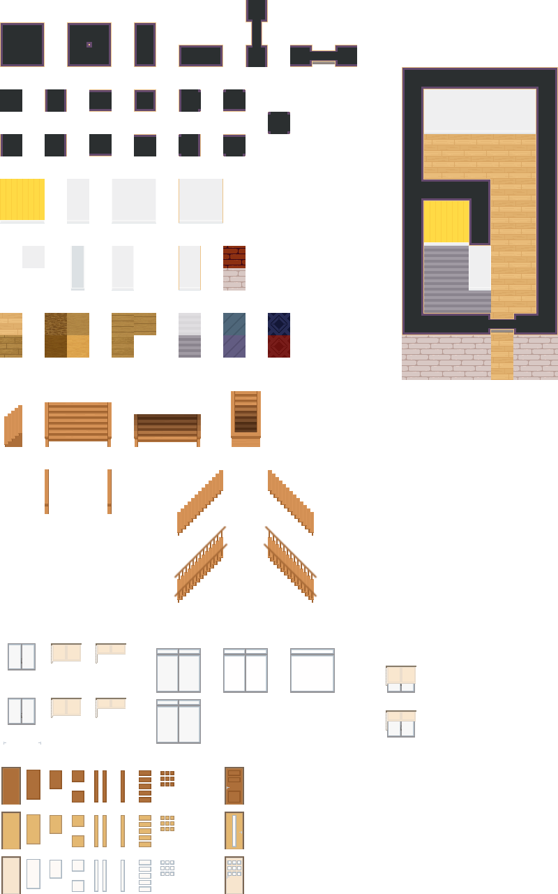

| Kategori Elemen | Deskripsi Visual | Rekomendasi Penggunaan Game |
| :--- | :--- | :--- |
| **Lantai Kayu (Parquet)** | Ubin papan kayu cokelat natural, kayu terang, dan kayu gelap | Ruang kerja utama, lobby kantor, koridor |
| **Lantai Karpet Modern** | Tekstur karpet abu-abu rapat, karpet biru navy, karpet krem | Ruang rapat (*Meeting Room*), studio/pod |
| **Lantai Keramik & Marmer** | Keramik putih mengkilap, marmer abu-abu modern | Pantri, kamar mandi, area resepsionis |
| **Tembok Dalam (Walls)** | Tembok cat putih bersih dengan lis bawah kayu/hitam | Dinding pembatas ruangan, dinding luar |
| **Dinding Kaca & Partisi** | Kaca semi-transparan dengan lis aluminium | Ruang rapat kaca modern (*glass office*) |
| **Kusen, Pintu & Jendela** | Pintu kayu terbuka/tertutup, bukaan jendela kaca | Akses antar ruangan, bukaan cahaya alami |

---

### 🌳 WA_Exterior.png (Lanskap Luar & Terbuka)
- **Fungsi:** Rumput outdoor, jalan setapak batu, trotoar aspal, pohon rindang, pagar pembatas kayu/besi, air kolam, dan tanaman luar.
- **Lokasi File:** `./tilesets/WA_Exterior.png`
- **Dimensi:** 800 × 1088 px (25 kolom × 34 baris = 850 tiles, @ 32x32 px)

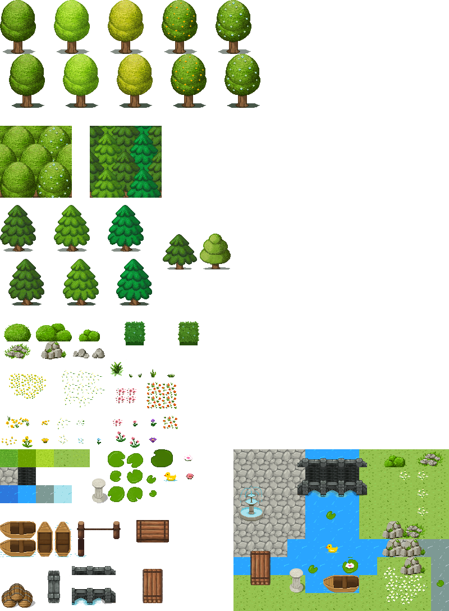

---

### 🎨 WA_Decoration.png (Dekorasi Dinding & Lantai)
- **Fungsi:** Karpet hias bundar & oval, papan tulis (*whiteboard*), layar proyektor, jam dinding, lukisan seni dinding, dan pot tanaman sudut besar.
- **Lokasi File:** `./tilesets/WA_Decoration.png`

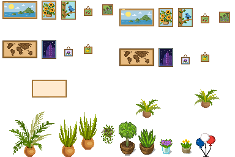

---

### ⚙️ WA_Special_Zones.png (Grid Utilitas & Collision)
- **Fungsi:** Penanda zona tabrakan (*collision* merah), titik spawn karakter (*start/spawn*), dan zona pintu portal keluar (*exit*).
- **Lokasi File:** `./tilesets/WA_Special_Zones.png`

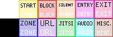

---

## 2. Katalog Meja (Tables & Desks)

Berikut daftar objek meja kerja, meja rapat, meja samping, dan meja kopi santai.

| Preview Visual | Nama Item | Tipe & Keterangan | File Path Lokal |
| :---: | :--- | :--- | :--- |
|  | **Table Brown** | Meja Kerja Kayu Cokelat Standar | `./items/Furniture/Table/TableBrown.png` |
|  | **Table Dark Brown** | Meja Kerja Kayu Cokelat Tua / Eksekutif | `./items/Furniture/Table/TableDarkBrown.png` |
|  | **Table Narrow Brown** | Meja Ramping Kayu Cokelat (Partisi/Lorong) | `./items/Furniture/Table/TableNarrowBrown.png` |
|  | **Table Narrow Dark Brown** | Meja Ramping Kayu Gelap | `./items/Furniture/Table/TableNarrowDarkBrown.png` |
|  | **Table Small White** | Meja Kopi / Meja Samping Minimalis Putih | `./items/Furniture/Table/TableSmallWhite.png` |
|  | **Table Small Grey** | Meja Kopi / Meja Samping Minimalis Abu-abu | `./items/Furniture/Table/TableSmallGrey.png` |

*(Untuk meja modular berukuran panjang, meja konferensi oval, dan meja sudut L-shape, tersedia di tileset `WA_Tables.png`)*:
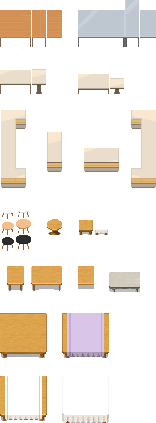

---

## 3. Katalog Kursi Kerja (Office Chairs)

Kursi kerja putar (*office swivel chair*) tersedia dalam **6 pilihan warna** dan **4 arah hadap** (Menghadap Bawah, Atas, Kiri, Kanan).

| Warna Kursi | Hadap Bawah (Down) | Hadap Atas (Up) | Hadap Kiri (Left) | Hadap Kanan (Right) | Path File Direktori |
| :--- | :---: | :---: | :---: | :---: | :--- |
| **Abu-Abu (Grey)** |  | 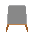 |  | 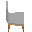 | `./items/Furniture/Chair/ChairGrey*.png` |
| **Biru (Blue)** |  |  |  | 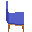 | `./items/Furniture/Chair/ChairBlue*.png` |
| **Hijau (Green)** |  |  |  |  | `./items/Furniture/Chair/ChairGreen*.png` |
| **Merah (Red)** |  |  |  | 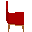 | `./items/Furniture/Chair/ChairRed*.png` |
| **Merah Muda (Light Red)** |  |  |  | 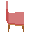 | `./items/Furniture/Chair/ChairLightRed*.png` |

*(Untuk bangku auditorium seminar dan kursi cafe tanpa roda, tersedia juga di tileset `WA_Seats.png`)*:
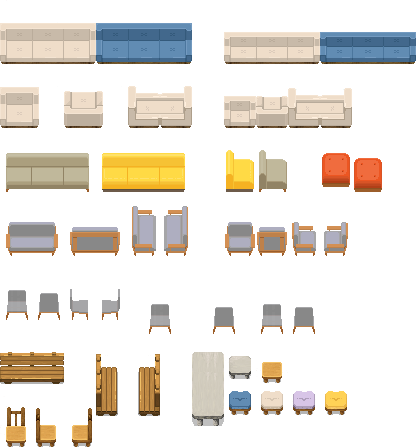

---

## 4. Katalog Kursi Santai & Sofa (Armchairs & Couches)

Cocok untuk area **Lounge, Lobby, Ruang Istirahat (Breakroom), dan Cafe**.

### 🛋️ Sofa Panjang 2-Dudukan (Couches)
Tersedia dalam 5 varian warna dan 4 arah hadap:

| Warna Sofa | Hadap Bawah (Down) | Hadap Atas (Up) | Hadap Kiri (Left) | Hadap Kanan (Right) | Path File Direktori |
| :--- | :---: | :---: | :---: | :---: | :--- |
| **Abu-Abu (Grey)** |  |  |  |  | `./items/Furniture/Couch/CouchGrey*.png` |
| **Biru (Blue)** |  |  |  |  | `./items/Furniture/Couch/CouchBlue*.png` |
| **Cokelat (Brown)** |  |  |  |  | `./items/Furniture/Couch/CouchBrown*.png` |
| **Hijau (Green)** |  |  |  |  | `./items/Furniture/Couch/CouchGreen*.png` |
| **Merah (Red)** |  |  |  |  | `./items/Furniture/Couch/CouchRed*.png` |

---

### 🪑 Kursi Santai Tunggal (Armchairs)
Tersedia dalam 5 varian warna dan 4 arah hadap:

| Warna Armchair | Hadap Bawah (Down) | Hadap Atas (Up) | Hadap Kiri (Left) | Hadap Kanan (Right) | Path File Direktori |
| :--- | :---: | :---: | :---: | :---: | :--- |
| **Hitam (Black)** |  |  |  |  | `./items/Furniture/Armchair/ArmchairBlack*.png` |
| **Abu-Abu (Grey)** |  |  |  |  | `./items/Furniture/Armchair/ArmchairGrey*.png` |
| **Biru (Blue)** |  |  |  |  | `./items/Furniture/Armchair/ArmchairBlue*.png` |
| **Hijau (Green)** |  |  |  |  | `./items/Furniture/Armchair/ArmchairGreen*.png` |
| **Merah (Red)** |  |  |  |  | `./items/Furniture/Armchair/ArmchairRed*.png` |

---

### 🟡 Kursi Bantal Bundar (Pouf)
| Preview Visual | Nama Item | Keterangan | File Path Lokal |
| :---: | :--- | :--- | :--- |
|  | **Pouf Orange** | Kursi bantal empuk bulat oranye | `./items/Furniture/PoufOrange.png` |
|  | **Pouf Brown** | Kursi bantal empuk bulat cokelat | `./items/Furniture/PoufBrown.png` |

---

## 5. Katalog Tanaman, Bunga & Dekorasi Alami

Tanaman hias indoor membuat suasana kantor tampak segar dan hidup.

| Preview Visual | Nama Item | Tipe & Warna Pot | File Path Lokal |
| :---: | :--- | :--- | :--- |
|  | **Large Plant** | Tanaman Palem Besar Sudut Ruangan | `./items/Office/Plant/PlantLarge.png` |
| 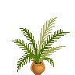 | **Plant (Green)** | Tanaman Hias Pot Hijau Standar | `./items/Office/Plant/Plant.png` |
|  | **Plant (Blue)** | Tanaman Hias Pot Biru | `./items/Office/Plant/PlantBlue.png` |
|  | **Plant (Cyan)** | Tanaman Hias Pot Biru Toska | `./items/Office/Plant/PlantCyan.png` |
| 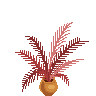 | **Plant (Red)** | Tanaman Bunga Pot Merah | `./items/Office/Plant/PlantRed.png` |
|  | **Small Plant (Green)** | Tanaman Meja Kecil Hijau | `./items/Office/Plant/PlantSmall.png` |
|  | **Small Plant (Blue)** | Tanaman Meja Kecil Pot Biru | `./items/Office/Plant/PlantSmallBlue.png` |
|  | **Small Plant (Cyan)** | Tanaman Meja Kecil Pot Toska | `./items/Office/Plant/PlantSmallCyan.png` |
|  | **Small Plant (Red)** | Tanaman Meja Kecil Pot Merah | `./items/Office/Plant/PlantSmallRed.png` |
| 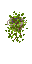 | **Mural / Suspended Plant** | Tanaman Gantung Dinding Vertikal | `./items/Office/Plant/MuralPlant.png` |

---

## 6. Katalog Komputer & Perangkat IT

Aset peralatan kerja elektronik untuk diletakkan di atas meja kerja (*workstation*).

| Preview Visual | Nama Item | Keterangan Posisi | File Path Lokal |
| :---: | :--- | :--- | :--- |
|  | **Monitor Hitam (Hadap Depan/Down)** | Layar monitor kerja tunggal | `./items/Office/Computer/ScreenBlackDown.png` |
|  | **Monitor Putih (Hadap Depan/Down)** | Layar monitor putih elegan | `./items/Office/Computer/ScreenWhiteDown.png` |
|  | **Monitor Hitam (Hadap Belakang/Up)** | Bagian punggung monitor hitam | `./items/Office/Computer/ScreenBlackUp.png` |
|  | **Monitor Putih (Hadap Belakang/Up)** | Bagian punggung monitor putih | `./items/Office/Computer/ScreenWhiteUp.png` |
|  | **Dual/Big Monitor Hitam (Down)** | Monitor ganda / ultra-wide | `./items/Office/Computer/BigScreenBlackDown.png` |
|  | **Dual/Big Monitor Putih (Down)** | Monitor ganda ultra-wide putih | `./items/Office/Computer/BigScreenWhiteDown.png` |
|  | **Dual/Big Monitor Hitam (Up)** | Punggung monitor ganda | `./items/Office/Computer/BigScreenBlackUp.png` |
|  | **Dual/Big Monitor Putih (Up)** | Punggung monitor ganda putih | `./items/Office/Computer/BigScreenWhiteUp.png` |
| 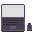 | **Laptop Hitam (Down)** | Laptop terbuka menghadap pemain | `./items/Office/Computer/LaptopBlackDown.png` |
| 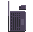 | **Laptop Hitam (Right)** | Laptop profil samping | `./items/Office/Computer/LaptopBlackRight.png` |
|  | **Office Printer** | Printer / Scanner kantor | `./items/Office/Computer/Printer.png` |

---

## 7. Katalog Lemari & Rak Penyimpanan (Shelves & Storage)

| Preview Visual | Nama Item | Keterangan | File Path Lokal |
| :---: | :--- | :--- | :--- |
| 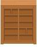 | **Big Shelf** | Lemari Buku & Dokumen Besar | `./items/Furniture/Shelf/ShelfBig.png` |
| 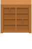 | **Standard Shelf** | Rak Buku Sedang Kayu | `./items/Furniture/Shelf/Shelf.png` |
|  | **Mural Shelf** | Rak Gantung Dinding Minimalis | `./items/Furniture/Shelf/MuralShelf.png` |

---

## 8. Katalog Aksesoris & Perlengkapan Kantor (Office Props)

| Preview Visual | Nama Item | Keterangan | File Path Lokal |
| :---: | :--- | :--- | :--- |
| 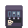 | **Coffee Dispenser** | Mesin Kopi Otomatis / Pantry | `./items/Office/Props/CoffeeDispenser.png` |
|  | **Round Mural Clock** | Jam Dinding Bulat Analog | `./items/Office/Props/Clock.png` |
| 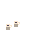 | **Coffee Mugs** | Cangkir Kopi Meja | `./items/Office/Props/Mugs.png` |
| 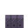 | **Office Folders** | Tumpukan Berkas & Map Dokumen | `./items/Office/Props/Folders.png` |
|  | **Book (Varian 1 - Merah)** | Buku Bacaan / Dokumen | `./items/Office/Props/Book1.png` |
|  | **Book (Varian 2 - Hijau)** | Buku Bacaan / Dokumen | `./items/Office/Props/Book2.png` |
|  | **Book (Varian 3 - Biru)** | Buku Bacaan / Dokumen | `./items/Office/Props/Book3.png` |
|  | **Book (Varian 4 - Kuning)** | Buku Bacaan / Dokumen | `./items/Office/Props/Book4.png` |
|  | **Book (Varian 5 - Oranye)** | Buku Bacaan / Dokumen | `./items/Office/Props/Book5.png` |
|  | **Trash Bin** | Tempat Sampah Kertas | `./items/Office/Props/Bin.png` |
| 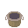 | **Waste Basket** | Keranjang Sampah Anyaman | `./items/Office/Props/Basket.png` |
|  | **Mural Mirror** | Cermin Dinding | `./items/Office/Props/Mirror.png` |
|  | **Pannel Kakemono Left** | Banner Partisi Ruangan Kiri | `./items/Furniture/Pannel/PannelLeft.png` |
|  | **Pannel Kakemono Right** | Banner Partisi Ruangan Kanan | `./items/Furniture/Pannel/PannelRight.png` |

---

## 9. Katalog Fasilitas Kamar Mandi (Restroom)

| Preview Visual | Nama Item | Keterangan | File Path Lokal |
| :---: | :--- | :--- | :--- |
|  | **Bathroom Sink** | Wastafel Cuci Tangan | `./items/Furniture/Bathroom/Sink.png` |
|  | **Toilet (Closed)** | Kloset Duduk Tertutup | `./items/Furniture/Bathroom/Toilet.png` |
|  | **Toilet (Open)** | Kloset Duduk Terbuka | `./items/Furniture/Bathroom/ToiletOpen.png` |
|  | **Toilet Paper** | Tisu Gulung Toilet | `./items/Office/Props/ToiletPaper.png` |
|  | **Toilet Brush** | Sikat Pembersih Toilet | `./items/Office/Props/ToiletBrush.png` |

---

## 10. Spesifikasi Teknis & Panduan Integrasi Game Lain

Jika Anda ingin mengimpor folder ini ke game engine lain (misalnya **Phaser 3, Godot 4, Unity, Cocos Creator, atau RPG Maker**):

1. **Ukuran Grid & Resolusi:**
   - Seluruh ubin pada direktori `tilesets/` dirancang dengan grid **32 × 32 piksel**, orientasi **orthogonal**.
   - Format file: **PNG 32-bit dengan alpha channel (transparan)**.
2. **Entity Objek (`items/`):**
   - Tiap item di folder `items/` sudah di-crop terpisah dengan latar belakang transparan.
   - Ukuran proporsional: kursi ($32\times 32$ atau $32\times 48$), meja ($64\times 32$ atau $96\times 48$), tanaman ($32\times 32$ hingga $64\times 64$).
3. **Metadata JSON:**
   - `FurnitureCollection.json` dan `OfficeCollection.json` memuat definisi nama, tag, arah hadap (*direction*), dan warna yang bisa diparsing otomatis oleh script game Anda.
